# Báo cáo tiến độ nghiên cứu ngày 31/10/2026
## A. Công việc đã làm
- Phát hiện lỗi mạch và cách khắc phục
- Hàn linh kiện vào mạch mới
- So sánh cảm biến mới với cảm biến cũ 
## B. Khó Khăn
## C. Báo cáo chi tiết 
### 1. Code chi tiết

### 2. Phát hiện lỗi khi kiểm tra mạch
#### Lỗi pad GND ở mặt bottom
- Pad GND ở mặt bottom không thông với GND toàn mạch
- Sau khi hàn từ pad GND bottom ra pcb chống nhiễu làm cho miếng chống nhiễu không được thông với đất
#### Kết quả đo giá trị ADC khi chưa khắc phục lỗi 
- Đồ thị khi không tác động

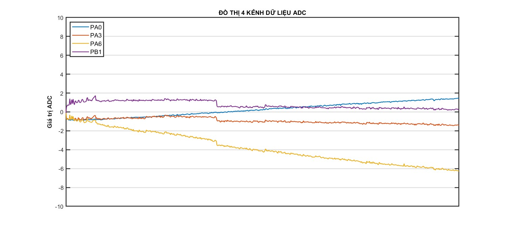

#### Cách khắc phục tạm thơi
- Câu dây từ pad GND top xuống pad GND bottom 
##### Kết quả: Sau khi câu dây thì pad GND bottom đã được thông với đất, miếng PCB chống nhiễu đã thông với đất
#### Cách khắc phục trong mạch PCB
- Thêm 1 net GND cho pad ở lớp bottom
- Hình ảnh sau khi sửa

  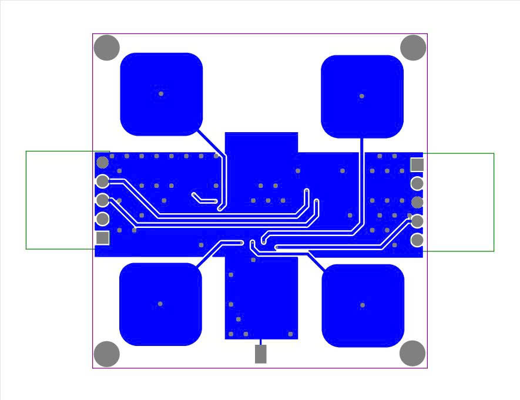
  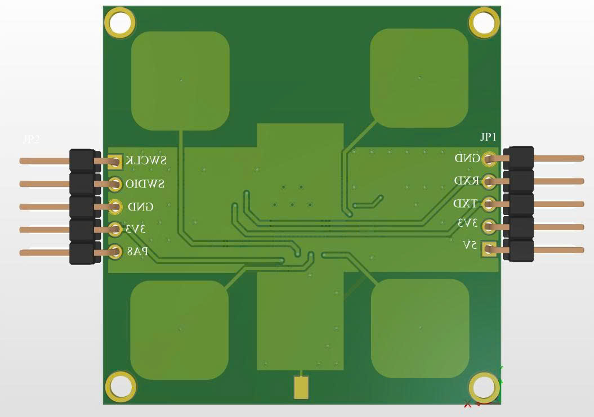

- File nguyên lí và các lớp pcb sau khi sửa
Link: https://drive.google.com/file/d/1dbz9rPhS7_fd7J9rCNb8mQ3JylEotMxW/view?usp=drive_link

#### Kết quả giá trị ADC sau khi đã khắc phục tạm thời

- Đồ thị khi không tác động

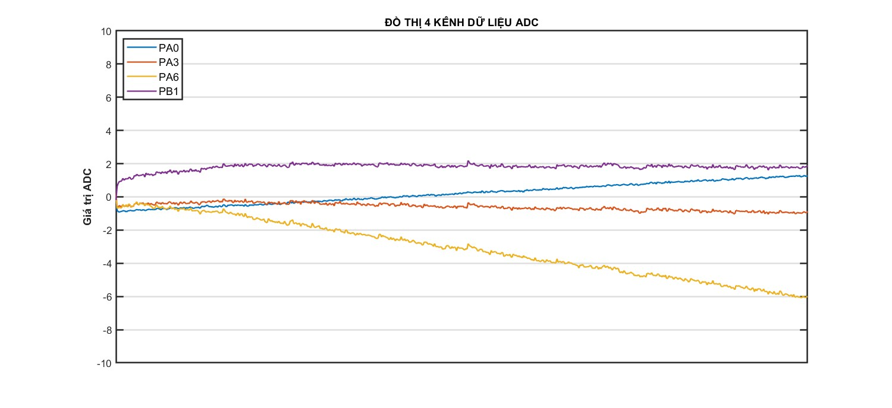

#### So sánh giá trị ADC trước và sau khi khắc phục lỗi

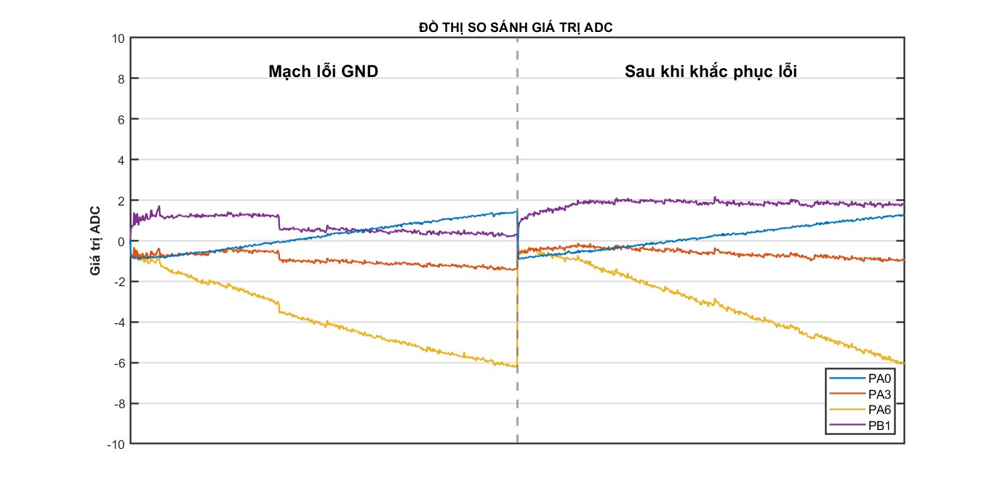

#### Nhận xét: Trước khi khắc phục lỗi có nhiều điểm nhiễu

### 3. Hàn mạch mới để so sánh mạch cũ
#### Tình hình linh kiện
- Tất cả linh kiện là mới hoàn toàn
- Được mua tại linh kiện chất lượng(Ngõ 116 đường Nguyễn Xiển)
#### Hàn mạch
- Được hàn bởi một anh D22DT 
- Trong quá trình hàn, nhóm em quan sát và đưa từng linh kiện để hàn
#### Kiểm tra mạch
- Đã kiểm tra thông các chân 3v3, gnd, chân swdio, chân swclk, chân rx, tx
- Kiểm tra 2 chân 3v3 và gnd không bị chập vào nhau
- Cấp nguồn vào đo các chân 3v3 có lên điện áp
- Vẫn bị lỗi pad GND bottom không thông với đất
#### Khắc phục mạch
- Tiến hành câu dây từ pad gnd top xuống gnd bottom
#### Hình ảnh mạch sau hàn

  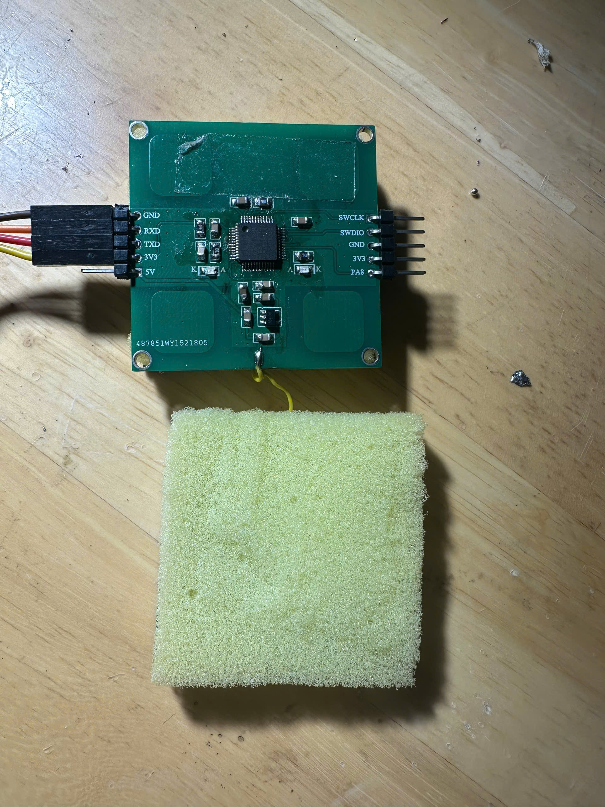
  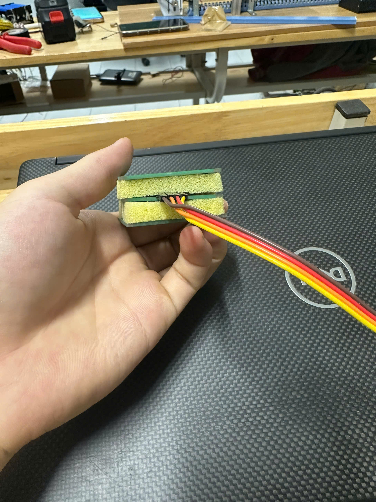

### 4. Đồ thị so sánh cảm biến cũ và cảm biến mới
- Mạch cũ đo 90 mẫu tổng thời gian 79.92ms
- Cả 2 đều đo sau khi đã khắc phục lỗi
#### Hình ảnh lúc đo
##### Cảm biến cũ

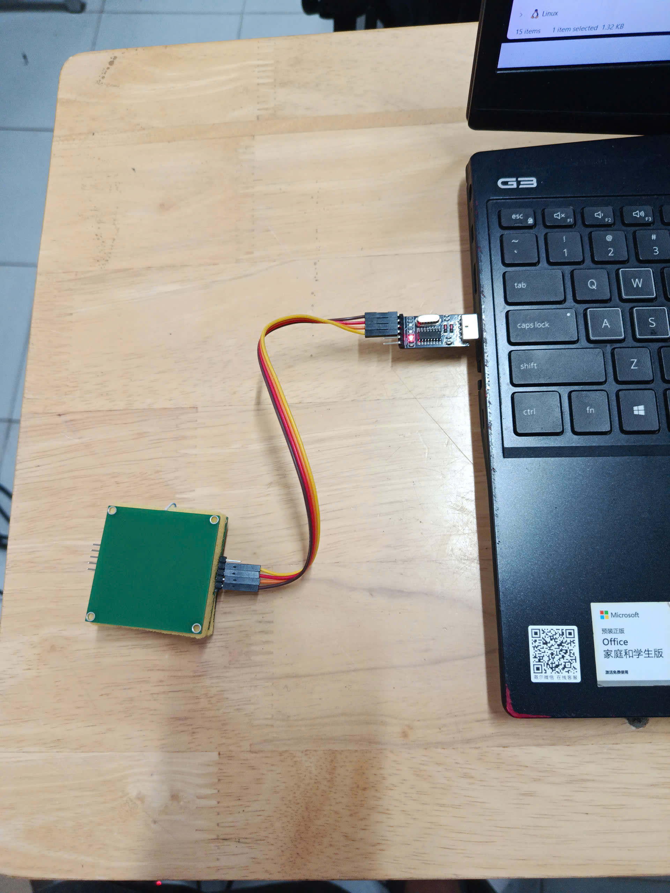

##### Cảm biến mới

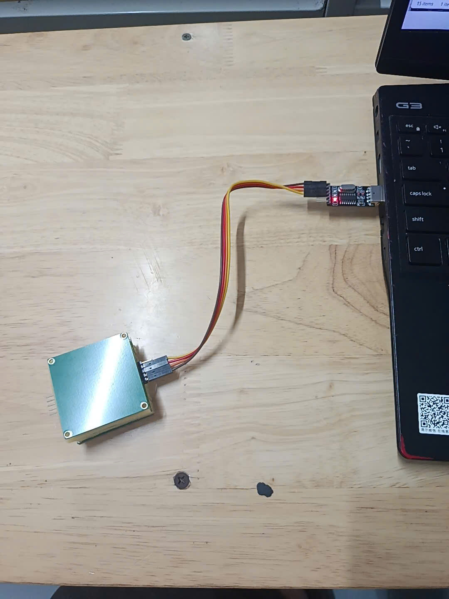

##### Mạch mới đo 100 mẫu tổng thời gian 80.36ms => Đồ thị so sánh

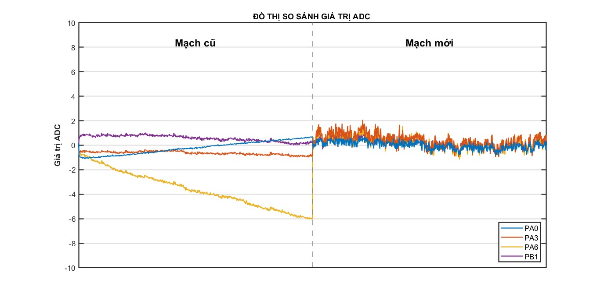

##### Mạch mới đo 99 mẫu tổng thời gian 79.55ms => Đồ thị so sánh

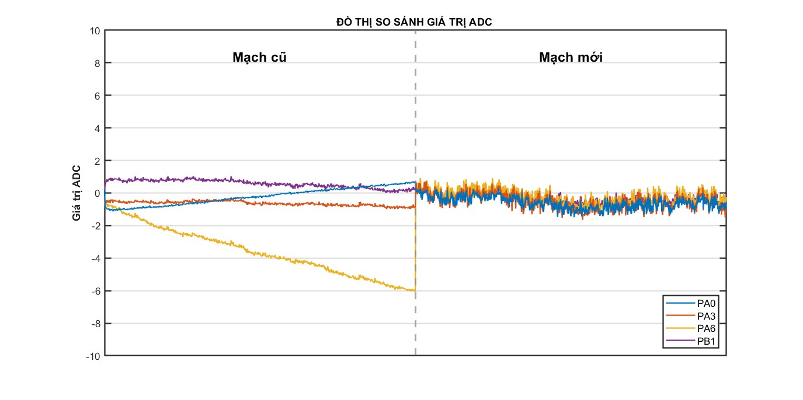

##### Nhận xét:
- Mạch mới giá trị xấp xỉ 0-2 nhưng bị nhiều gai nhọn